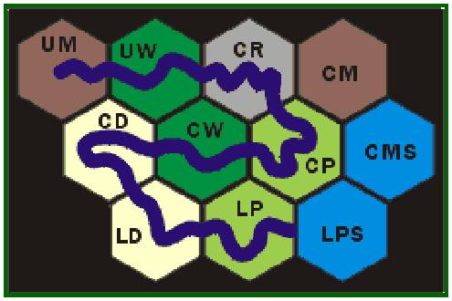

# A River Runs Through It

## Metadata
- **Scenario ID**: `river_runs_through_it` (`mapPresetId`: `scenario_river_runs_through_it`)
- **Source**: `http://www.splotter.nl/english/r&b/arrti.html`
- **Goal**: Find how to get the most points on the map shown.
- **Conditions**: Play without the Planes & Trains expansion set; skip the first four rows of the wonder; play 20 turns.
- **Current Record**: **300** (1 share, 2 coins, 2 gold, 8 wonder rows) — by Gary Brennan
- **Level**: modest
- **Status**: well-studied

## Scenario Briefing & Rules
> This puzzling little map is quite hard to figure out. When we released the first edition of Roads & Boats, we thought that 270 points was the maximum. By the time we released the second edition, Herman had found a 300 point solution. The amazing thing about that solution was the fact that five donkeys were the only means of transport. But even these five simple donkeys can earn 300 points if you use exactly the right road network and have all parts of the schedule fit exactly together.
>
> We thought this was the only way to do it, until Gary Brennan showed us how this map should really be handled. Suddenly, it all looked easy. His solution, also for 300 points, involves donkeys, rafts and a minimal road network. Despite the near-absence of roads, the transport system runs very smoothly. No complicated just-the-right-move schemes; instead, in turn 11 to 19, the donkeys spend 70% of their time running turnly or two-turnly schedules, and even 13% of their time resting. Gary's solution has a superb finishing touch: in the last turn, everything, transporters as well as goods, is gathered at the starting place.
>
> You can start on any tile on the board. Before playing, fill the first four rows of the wonder with bricks of unused colours. This means that the first wonder brick in a turn costs two goods right from the beginning. The maximum number of points you can get in the wonder is 80 - the game ends at the two-player mark. You have only 20 turns instead of the usual 33 to finish the game: 13 neutral bricks will not be used. Play by the rules of the second edition. For mining, use the one-player rule (see scenario book).

## Exact Map Geometry
- **Hex Orientation**: `pointy` (horizontal staggered rows: `4 - 4 - 3`)
- **Total Tiles**: 11
- **Default App Starting Hex**: `LP` `(0, 1)` (lower pasture)

### Tiles (`(q, r)` Axial)
| Row (`r`) | Code | `(q, r)` | Terrain | Notes |
|-----------|------|----------|---------|-------|
| `-1` | `UM` | `(-1, -1)` | `mountain` | River source |
| `-1` | `UW` | `(0, -1)` | `forest` | River hex 2 |
| `-1` | `CR` | `(1, -1)` | `rock` | River hex 3 |
| `-1` | `CM` | `(2, -1)` | `mountain` | NE mountain |
| `0` | `CD` | `(-1, 0)` | `desert` | River hex 6 |
| `0` | `CW` | `(0, 0)` | `forest` | River hex 5 |
| `0` | `CP` | `(1, 0)` | `pasture` | River hex 4 |
| `0` | `CMS` | `(2, 0)` | `water` | East sea |
| `+1` | `LD` | `(-1, 1)` | `desert` | River hex 7 |
| `+1` | `LP` | `(0, 1)` | `pasture` | River hex 8 (Default home) |
| `+1` | `LPS` | `(1, 1)` | `water` | River mouth sea |

### Rivers (8 Edges — Single Continuous Winding River)
1. `UM (-1, -1) <-> UW (0, -1)`
2. `UW (0, -1) <-> CR (1, -1)`
3. `CR (1, -1) <-> CP (1, 0)`
4. `CP (1, 0) <-> CW (0, 0)`
5. `CW (0, 0) <-> CD (-1, 0)`
6. `CD (-1, 0) <-> LD (-1, 1)`
7. `LD (-1, 1) <-> LP (0, 1)`
8. `LP (0, 1) <-> LPS (1, 1)` (river flows into sea `LPS`)

### Railroads
- None.
