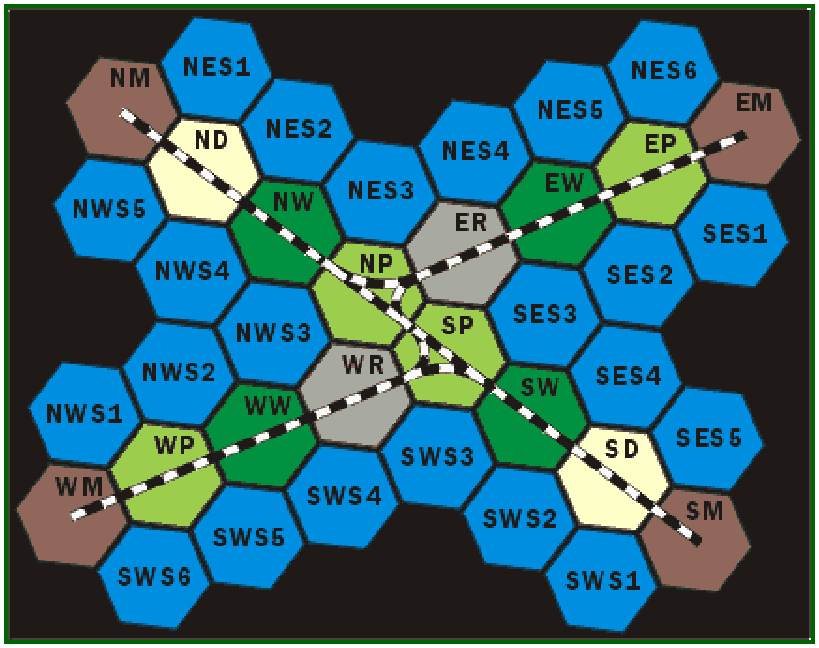

# Charing Cross

## Metadata
- **Scenario ID**: `charing_cross` (`mapPresetId`: `scenario_charing_cross`)
- **Source**: `http://www.splotter.nl/english/r&b/charx.html`
- **Goal**: Find how to get the most points on the map shown.
- **Conditions**: You may take advantage of the Planes & Trains expansion set; skip the first four rows of the wonder; play 20 turns.
- **Current Record**: **450** (3 shares, 1 coin, 1 gold, 4 wonder rows) — by Herman Haverkort
- **Level**: modest
- **Status**: experimental

## Scenario Briefing & Rules
> Experiment with the different possibilities for long distance transportation. Are you going to use public transport or will you rely on your own means of transport? How are land, water and air transporters best used?
>
> You can start on any tile on the board. Before playing, fill the first four rows of the wonder with bricks of unused colours. This means that the first wonder brick in a turn costs two goods right from the beginning. The maximum number of points you can get in the wonder is 80 - the game ends at the two-player mark. You have only 20 turns instead of the usual 33 to finish the game: 13 neutral bricks will not be used. Play by the rules of the second edition. For mining, use the one-player rule (see scenario book).

## Exact Map Geometry
- **Hex Orientation**: `flat` (X-shaped intersecting corridors flanked by 4 coastal sea belts; Splotter's diagram is tilted ~5.5° counterclockwise from pure flat-top so the X fills the frame symmetrically)
- **Total Tiles**: 38 (16 land tiles along two intersecting railroad corridors + 22 coastal sea tiles `NES1..6`, `NWS1..5`, `SES1..5`, `SWS1..6`)
- **Default App Starting Hex**: `NP` `(0, 0)` (north central pasture)

### Tiles (`(q, r)` Axial)
| Group | Code | `(q, r)` | Terrain | Notes |
|-------|------|----------|---------|-------|
| NW-SE Rail | `NM` | `(0, -3)` | `mountain` | NW peak terminus |
| NW-SE Rail | `ND` | `(0, -2)` | `desert` | NW desert |
| NW-SE Rail | `NW` | `(0, -1)` | `forest` | NW forest |
| Center Hub | `NP` | `(0, 0)` | `pasture` | North hub / NE rail branch (Default home) |
| Center Hub | `SP` | `(0, 1)` | `pasture` | South hub / SW rail branch |
| NW-SE Rail | `SW` | `(0, 2)` | `forest` | SE forest |
| NW-SE Rail | `SD` | `(0, 3)` | `desert` | SE desert |
| NW-SE Rail | `SM` | `(0, 4)` | `mountain` | SE peak terminus |
| NE Rail Arm | `ER` | `(1, 0)` | `rock` | East rock |
| NE Rail Arm | `EW` | `(2, 0)` | `forest` | East forest |
| NE Rail Arm | `EP` | `(3, 0)` | `pasture` | East pasture |
| NE Rail Arm | `EM` | `(4, 0)` | `mountain` | NE peak terminus |
| SW Rail Arm | `WR` | `(-1, 1)` | `rock` | West rock |
| SW Rail Arm | `WW` | `(-2, 1)` | `forest` | West forest |
| SW Rail Arm | `WP` | `(-3, 1)` | `pasture` | West pasture |
| SW Rail Arm | `WM` | `(-4, 1)` | `mountain` | SW peak terminus |
| NE Sea Belt | `NES1` | `(1, -3)` | `water` | Outer NE sea |
| NE Sea Belt | `NES2` | `(1, -2)` | `water` | Outer NE sea |
| NE Sea Belt | `NES3` | `(1, -1)` | `water` | Inner NE bay |
| NE Sea Belt | `NES4` | `(2, -1)` | `water` | Outer NE sea |
| NE Sea Belt | `NES5` | `(3, -1)` | `water` | Outer NE sea |
| NE Sea Belt | `NES6` | `(4, -1)` | `water` | Far NE sea |
| NW Sea Belt | `NWS1` | `(-3, 0)` | `water` | Far NW sea |
| NW Sea Belt | `NWS2` | `(-2, 0)` | `water` | Outer NW sea |
| NW Sea Belt | `NWS3` | `(-1, 0)` | `water` | Inner NW bay |
| NW Sea Belt | `NWS4` | `(-1, -1)` | `water` | Outer NW sea |
| NW Sea Belt | `NWS5` | `(-1, -2)` | `water` | Far NW sea |
| SE Sea Belt | `SES1` | `(3, 1)` | `water` | Far SE sea |
| SE Sea Belt | `SES2` | `(2, 1)` | `water` | Outer SE sea |
| SE Sea Belt | `SES3` | `(1, 1)` | `water` | Inner SE bay |
| SE Sea Belt | `SES4` | `(1, 2)` | `water` | Outer SE sea |
| SE Sea Belt | `SES5` | `(1, 3)` | `water` | Far SE sea |
| SW Sea Belt | `SWS1` | `(-1, 4)` | `water` | Far SW sea |
| SW Sea Belt | `SWS2` | `(-1, 3)` | `water` | Outer SW sea |
| SW Sea Belt | `SWS3` | `(-1, 2)` | `water` | Inner SW bay |
| SW Sea Belt | `SWS4` | `(-2, 2)` | `water` | Outer SW sea |
| SW Sea Belt | `SWS5` | `(-3, 2)` | `water` | Outer SW sea |
| SW Sea Belt | `SWS6` | `(-4, 2)` | `water` | Far SW sea |

### Rivers
- None.

### Railroads (15 Edges — Central Y-Switched Cross)
- **NW-SE Mainline (7 edges)**:
  - `NM (0, -3) <-> ND (0, -2) <-> NW (0, -1) <-> NP (0, 0) <-> SP (0, 1) <-> SW (0, 2) <-> SD (0, 3) <-> SM (0, 4)`
- **NE Branch from `NP` (4 edges)**:
  - `NP (0, 0) <-> ER (1, 0) <-> EW (2, 0) <-> EP (3, 0) <-> EM (4, 0)`
- **SW Branch from `SP` (4 edges)**:
  - `WM (-4, 1) <-> WP (-3, 1) <-> WW (-2, 1) <-> WR (-1, 1) <-> SP (0, 1)`
