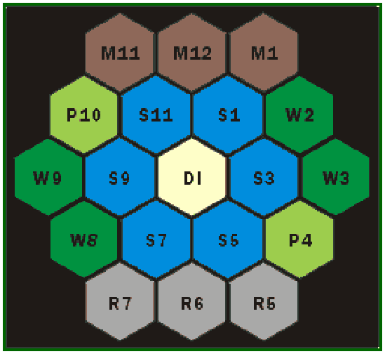

# Lord of the Ring

## Metadata
- **Scenario ID**: `lord_of_the_ring` (`mapPresetId`: `scenario_lord_of_the_ring`)
- **Source**: `http://www.splotter.nl/english/r&b/lotr.html`
- **Goal**: Find how to get the most points on the map shown.
- **Conditions**: Play without the Planes & Trains expansion set; skip the first four rows of the wonder; play 20 turns.
- **Current Record**: **360** (2 shares, 2 coins, 4 wonder rows) — by Werner Bär
- **Level**: difficult
- **Status**: experimental

## Scenario Briefing & Rules
> A nice little sea, ideal for rafts and rowboats. However, water transporters can dock only once in a turn. They are ideal for big transports over big distances, but bad at small, fast, short-distance deliveries. How will your water transporters cooperate with your land transporters to get everything at the right place at the right time? And how will you deal with the fact that this sea is just a little too large to be crossed by a raft in one turn?
>
> You can start on any tile on the board. Before playing, fill the first four rows of the wonder with bricks of unused colours. This means that the first wonder brick in a turn costs two goods right from the beginning. The maximum number of points you can get in the wonder is 80 - the game ends at the two-player mark. You have only 20 turns instead of the usual 33 to finish the game: 13 neutral bricks will not be used. Play by the rules of the second edition. For mining, use the one-player rule (see scenario book).

## Exact Map Geometry
- **Hex Orientation**: `pointy` (horizontal staggered rows: `3 - 4 - 5 - 4 - 3`)
- **Total Tiles**: 19 (central island `DI`, 6-hex inland sea ring, 12-hex outer perimeter ring)
- **Default App Starting Hex**: `P10` `(-1, -1)` (pasture)

### Tiles (`(q, r)` Axial)
| Row (`r`) | Code | `(q, r)` | Terrain | Notes |
|-----------|------|----------|---------|-------|
| `-2` | `M11` | `(0, -2)` | `mountain` | Outer ring |
| `-2` | `M12` | `(1, -2)` | `mountain` | Outer ring |
| `-2` | `M1` | `(2, -2)` | `mountain` | Outer ring |
| `-1` | `P10` | `(-1, -1)` | `pasture` | Outer ring; default home |
| `-1` | `S11` | `(0, -1)` | `water` | Inland sea ring |
| `-1` | `S1` | `(1, -1)` | `water` | Inland sea ring |
| `-1` | `W2` | `(2, -1)` | `forest` | Outer ring |
| `0` | `W9` | `(-2, 0)` | `forest` | Outer ring |
| `0` | `S9` | `(-1, 0)` | `water` | Inland sea ring |
| `0` | `DI` | `(0, 0)` | `desert` | Central Desert Island |
| `0` | `S3` | `(1, 0)` | `water` | Inland sea ring |
| `0` | `W3` | `(2, 0)` | `forest` | Outer ring |
| `+1` | `W8` | `(-2, 1)` | `forest` | Outer ring |
| `+1` | `S7` | `(-1, 1)` | `water` | Inland sea ring |
| `+1` | `S5` | `(0, 1)` | `water` | Inland sea ring |
| `+1` | `P4` | `(1, 1)` | `pasture` | Outer ring |
| `+2` | `R7` | `(-2, 2)` | `rock` | Outer ring |
| `+2` | `R6` | `(-1, 2)` | `rock` | Outer ring |
| `+2` | `R5` | `(0, 2)` | `rock` | Outer ring |

### Rivers & Railroads
- None.
