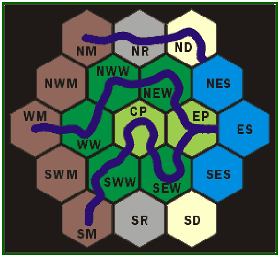

# Mesopotamia

## Metadata
- **Scenario ID**: `mesopotamia` (`mapPresetId`: `scenario_mesopotamia`)
- **Source**: `http://www.splotter.nl/english/r&b/mesopotamia.html`
- **Goal**: Find how to get the most points on the map shown.
- **Conditions**: Play without the Planes & Trains expansion set; skip the first four rows of the wonder; play 20 turns.
- **Current Record**: **440** (2 shares, 4 coins, 1 gold, 3 wonder rows) — by Herman Haverkort
- **Level**: modest
- **Status**: experimental

## Scenario Briefing & Rules
> A puzzle with lots of resources. Although it is a compact map, rivers make the distances relatively large, both over land and over water. How much stone will you need to build roads and bridges, and where will you get it?
>
> You can start on any tile on the board. Before playing, fill the first four rows of the wonder with bricks of unused colours. This means that the first wonder brick in a turn costs two goods right from the beginning. The maximum number of points you can get in the wonder is 80 - the game ends at the two-player mark. You have only 20 turns instead of the usual 33 to finish the game: 13 neutral bricks will not be used. Play by the rules of the second edition. For mining, use the one-player rule (see scenario book).

## Exact Map Geometry
- **Hex Orientation**: `pointy` (horizontal staggered rows: `3 - 4 - 5 - 4 - 3`)
- **Total Tiles**: 19
- **Default App Starting Hex**: `CP` `(0, 0)` (pasture)

### Tiles (`(q, r)` Axial)
| Row (`r`) | Code | `(q, r)` | Terrain | Notes |
|-----------|------|----------|---------|-------|
| `-2` | `NM` | `(0, -2)` | `mountain` | Northern river source |
| `-2` | `NR` | `(1, -2)` | `rock` | Northern river |
| `-2` | `ND` | `(2, -2)` | `desert` | Northern river mouth to `NES` |
| `-1` | `NWM` | `(-1, -1)` | `mountain` | |
| `-1` | `NWW` | `(0, -1)` | `forest` | Central-west river |
| `-1` | `NEW` | `(1, -1)` | `forest` | Central-west river |
| `-1` | `NES` | `(2, -1)` | `water` | Receives northern river |
| `0` | `WM` | `(-2, 0)` | `mountain` | Western river source |
| `0` | `WW` | `(-1, 0)` | `forest` | Western river |
| `0` | `CP` | `(0, 0)` | `pasture` | Southern river; default home |
| `0` | `EP` | `(1, 0)` | `pasture` | River confluence draining to `ES` |
| `0` | `ES` | `(2, 0)` | `water` | Receives combined rivers |
| `+1` | `SWM` | `(-2, 1)` | `mountain` | |
| `+1` | `SWW` | `(-1, 1)` | `forest` | Southern river |
| `+1` | `SEW` | `(0, 1)` | `forest` | Southern river |
| `+1` | `SES` | `(1, 1)` | `water` | |
| `+2` | `SM` | `(-2, 2)` | `mountain` | Southern river source |
| `+2` | `SR` | `(-1, 2)` | `rock` | |
| `+2` | `SD` | `(0, 2)` | `desert` | |

### Rivers (11 Edges)
- **Northern river**:
  - `NM (0, -2) <-> NR (1, -2)`
  - `NR (1, -2) <-> ND (2, -2)`
  - `ND (2, -2) <-> NES (2, -1)`
- **Western tributary (to `EP`)**:
  - `WM (-2, 0) <-> WW (-1, 0)`
  - `WW (-1, 0) <-> NWW (0, -1)`
  - `NWW (0, -1) <-> NEW (1, -1)`
  - `NEW (1, -1) <-> EP (1, 0)`
- **Southern tributary (to `EP`)**:
  - `SM (-2, 2) <-> SWW (-1, 1)`
  - `SWW (-1, 1) <-> CP (0, 0)`
  - `CP (0, 0) <-> SEW (0, 1)`
  - `SEW (0, 1) <-> EP (1, 0)`
- **Outflow**: `EP (1, 0) <-> ES (2, 0)` (note: `ES` is open water, already traversable by watercraft; marked as river/water mouth in diagram)

### Railroads
- None.
