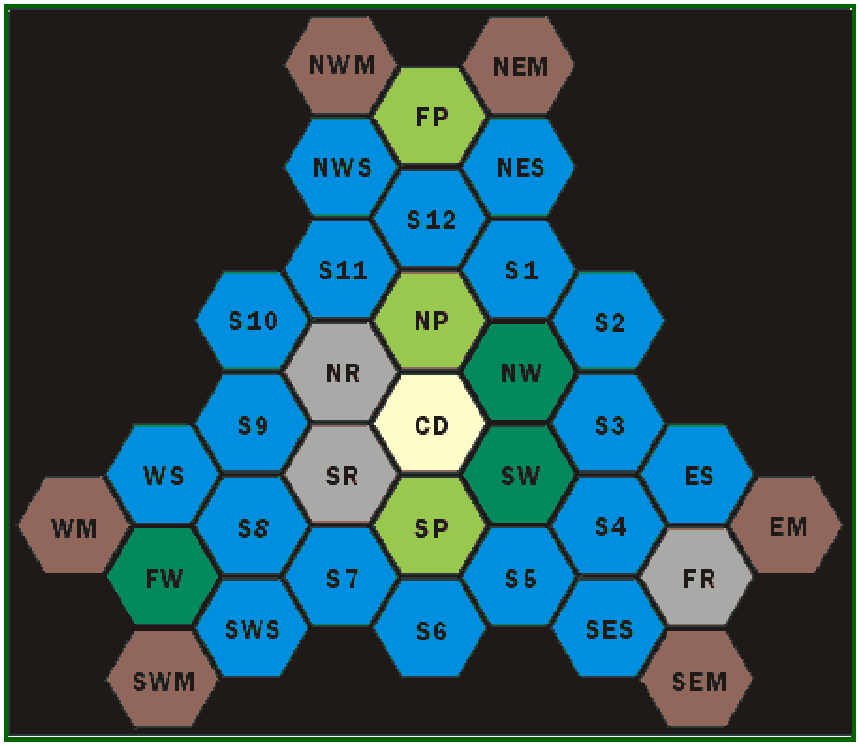

# Rocket Science

## Metadata
- **Scenario ID**: `rocket_science` (`mapPresetId`: `scenario_rocket_science`)
- **Source**: `http://www.splotter.nl/english/r&b/rocks.html`
- **Goal**: Find how to get the most points on the map shown.
- **Conditions**: You may take advantage of the Planes & Trains expansion set; skip the first four rows of the wonder; play 20 turns.
- **Current Record**: **390** (2 shares, 1 coin, 7 gold, 4 wonder rows) — by Herman Haverkort
- **Level**: modest
- **Status**: experimental

## Scenario Briefing & Rules
> Three small islands waiting to be colonized. Will you take all of them, or just one or two?
>
> You can start on any tile on the board. Before playing, fill the first four rows of the wonder with bricks of unused colours. This means that the first wonder brick in a turn costs two goods right from the beginning. The maximum number of points you can get in the wonder is 80 - the game ends at the two-player mark. You have only 20 turns instead of the usual 33 to finish the game: 13 neutral bricks will not be used. Play by the rules of the second edition. For mining, use the one-player rule (see scenario book).

## Exact Map Geometry
- **Hex Orientation**: `flat` (vertical staggered columns: `1 - 3 - 4 - 6 - 6 - 6 - 4 - 3 - 1`, symmetric triangular sea surrounding a 7-hex main island and 3 three-hex corner resource islands)
- **Total Tiles**: 34 (7 central island tiles + 9 corner-island tiles + 18 sea tiles)
- **Default App Starting Hex**: `NP` `(0, -1)` (north pasture on main island)

### Tiles (`(q, r)` Axial — Flat-Topped)
| Col (`q`) | Code | `(q, r)` | Terrain | Notes |
|-----------|------|----------|---------|-------|
| `-4` | `WM` | `(-4, 3)` | `mountain` | SW island |
| `-3` | `WS` | `(-3, 2)` | `water` | West outer sea |
| `-3` | `FW` | `(-3, 3)` | `forest` | SW island |
| `-3` | `SWM` | `(-3, 4)` | `mountain` | SW island |
| `-2` | `S10` | `(-2, 0)` | `water` | Inland sea ring |
| `-2` | `S9` | `(-2, 1)` | `water` | Inland sea ring |
| `-2` | `S8` | `(-2, 2)` | `water` | Inland sea ring |
| `-2` | `SWS` | `(-2, 3)` | `water` | SW outer sea |
| `-1` | `NWM` | `(-1, -3)` | `mountain` | North island |
| `-1` | `NWS` | `(-1, -2)` | `water` | NW outer sea |
| `-1` | `S11` | `(-1, -1)` | `water` | Inland sea ring |
| `-1` | `NR` | `(-1, 0)` | `rock` | Main island NW |
| `-1` | `SR` | `(-1, 1)` | `rock` | Main island SW |
| `-1` | `S7` | `(-1, 2)` | `water` | Inland sea ring |
| `0` | `FP` | `(0, -3)` | `pasture` | North island |
| `0` | `S12` | `(0, -2)` | `water` | Inland sea ring |
| `0` | `NP` | `(0, -1)` | `pasture` | Main island N (Default home) |
| `0` | `CD` | `(0, 0)` | `desert` | Main island center |
| `0` | `SP` | `(0, 1)` | `pasture` | Main island S |
| `0` | `S6` | `(0, 2)` | `water` | Inland sea ring |
| `+1` | `NEM` | `(1, -4)` | `mountain` | North island |
| `+1` | `NES` | `(1, -3)` | `water` | NE outer sea |
| `+1` | `S1` | `(1, -2)` | `water` | Inland sea ring |
| `+1` | `NW` | `(1, -1)` | `forest` | Main island NE |
| `+1` | `SW` | `(1, 0)` | `forest` | Main island SE |
| `+1` | `S5` | `(1, 1)` | `water` | Inland sea ring |
| `+2` | `S2` | `(2, -2)` | `water` | Inland sea ring |
| `+2` | `S3` | `(2, -1)` | `water` | Inland sea ring |
| `+2` | `S4` | `(2, 0)` | `water` | Inland sea ring |
| `+2` | `SES` | `(2, 1)` | `water` | SE outer sea |
| `+3` | `ES` | `(3, -1)` | `water` | East outer sea |
| `+3` | `FR` | `(3, 0)` | `rock` | SE island |
| `+3` | `SEM` | `(3, 1)` | `mountain` | SE island |
| `+4` | `EM` | `(4, -1)` | `mountain` | SE island |

### Rivers & Railroads
- None.
