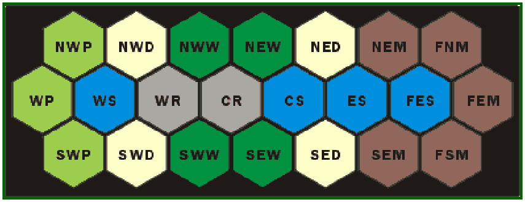

# Sea For One

## Metadata
- **Scenario ID**: `sea_for_one` (`mapPresetId`: `scenario_sea_for_one`)
- **Source**: `http://www.splotter.nl/english/r&b/sfo.html`
- **Goal**: Find how to get the most points on the map shown.
- **Conditions**: Play without the Planes & Trains expansion set; skip the first four rows of the wonder; play 20 turns.
- **Current Record**: **420** (3 shares, 6 wonder rows) — by Hannes Ernst
- **Level**: difficult
- **Status**: well-studied

## Scenario Briefing & Rules
> In this puzzle you have quite a lot of raw materials and enough room to build a lot of factories. The problem is that there are small seas between the three main areas of interest. Luckily, they are also connected by four small deserts, so you can use both land and water transporters to go from one area to another.
>
> This scenario is interesting as a puzzle for more experienced players. Beginners may use it to gain experience in understanding the different possibilities of land and sea transporters, respectively.
>
> You can start on any tile on the board. Before playing, fill the first four rows of the wonder with bricks of unused colours. This means that the first wonder brick in a turn costs two goods right from the beginning. The maximum number of points you can get in the wonder is 80 - the game ends at the two-player mark. You have only 20 turns instead of the usual 33 to finish the game: 13 neutral bricks will not be used. Play by the rules of the second edition. For mining, use the one-player rule (see scenario book).

## Exact Map Geometry
- **Hex Orientation**: `pointy` (horizontal staggered bands: `7 - 8 - 7`)
- **Total Tiles**: 22
- **Default App Starting Hex**: `WP` `(-3, 0)` (pasture)

### Tiles (`(q, r)` Axial)
| Row (`r`) | Code | `(q, r)` | Terrain | Notes |
|-----------|------|----------|---------|-------|
| `-1` | `NWP` | `(-2, -1)` | `pasture` | West pasture cluster |
| `-1` | `NWD` | `(-1, -1)` | `desert` | West-center desert bridge |
| `-1` | `NWW` | `(0, -1)` | `forest` | Central woodland |
| `-1` | `NEW` | `(1, -1)` | `forest` | Central woodland |
| `-1` | `NED` | `(2, -1)` | `desert` | Center-east desert bridge |
| `-1` | `NEM` | `(3, -1)` | `mountain` | East mountain cluster |
| `-1` | `FNM` | `(4, -1)` | `mountain` | Far-east mountain cluster |
| `0` | `WP` | `(-3, 0)` | `pasture` | Default home |
| `0` | `WS` | `(-2, 0)` | `water` | Western sea |
| `0` | `WR` | `(-1, 0)` | `rock` | Central rock |
| `0` | `CR` | `(0, 0)` | `rock` | Central rock |
| `0` | `CS` | `(1, 0)` | `water` | Eastern sea |
| `0` | `ES` | `(2, 0)` | `water` | Eastern sea |
| `0` | `FES` | `(3, 0)` | `water` | Eastern sea |
| `0` | `FEM` | `(4, 0)` | `mountain` | Far-east mountain cluster |
| `+1` | `SWP` | `(-3, 1)` | `pasture` | West pasture cluster |
| `+1` | `SWD` | `(-2, 1)` | `desert` | West-center desert bridge |
| `+1` | `SWW` | `(-1, 1)` | `forest` | Central woodland |
| `+1` | `SEW` | `(0, 1)` | `forest` | Central woodland |
| `+1` | `SED` | `(1, 1)` | `desert` | Center-east desert bridge |
| `+1` | `SEM` | `(2, 1)` | `mountain` | East mountain cluster |
| `+1` | `FSM` | `(3, 1)` | `mountain` | Far-east mountain cluster |

### Rivers & Railroads
- None.
