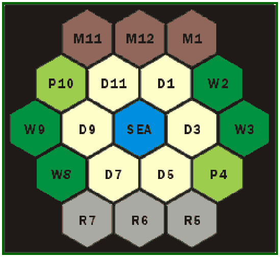

# Sheikh of the Ring

## Metadata
- **Scenario ID**: `sheikh_of_the_ring` (`mapPresetId`: `scenario_sheikh_of_the_ring`)
- **Source**: `http://www.splotter.nl/english/r&b/sotr.html`
- **Goal**: Find how to get the most points on the map shown.
- **Conditions**: You may take advantage of the Planes & Trains expansion set; skip the first four rows of the wonder; play 20 turns.
- **Current Record**: **350** (2 shares, 1 coin, 4 gold, 3 wonder rows) — by Herman Haverkort
- **Level**: difficult
- **Status**: experimental

## Scenario Briefing & Rules
> A nice little desert, inaccessible for rafts and rowboats, dreadful for wagons (at least as long as there are no roads), and exhausting for donkeys. But do not underestimate them! Can you find out what the poor surface transporters can still achieve with proper air-support? Can you win by using explosives to "recycle" scarce cultivable land, or would such fires take too much wood?
>
> You can start on any tile on the board. Before playing, fill the first four rows of the wonder with bricks of unused colours. This means that the first wonder brick in a turn costs two goods right from the beginning. The maximum number of points you can get in the wonder is 80 - the game ends at the two-player mark. You have only 20 turns instead of the usual 33 to finish the game: 13 neutral bricks will not be used. Play by the rules of the second edition. For mining, use the one-player rule (see scenario book).

## Exact Map Geometry
- **Hex Orientation**: `pointy` (horizontal staggered rows: `3 - 4 - 5 - 4 - 3`)
- **Total Tiles**: 19 (central `SEA`, 6-hex inner desert ring, 12-hex outer perimeter ring)
- **Default App Starting Hex**: `P10` `(-1, -1)` (northwest pasture)

### Tiles (`(q, r)` Axial)
| Row (`r`) | Code | `(q, r)` | Terrain | Notes |
|-----------|------|----------|---------|-------|
| `-2` | `M11` | `(0, -2)` | `mountain` | Outer ring |
| `-2` | `M12` | `(1, -2)` | `mountain` | Outer ring |
| `-2` | `M1` | `(2, -2)` | `mountain` | Outer ring |
| `-1` | `P10` | `(-1, -1)` | `pasture` | Outer ring (Default home) |
| `-1` | `D11` | `(0, -1)` | `desert` | Inner desert ring |
| `-1` | `D1` | `(1, -1)` | `desert` | Inner desert ring |
| `-1` | `W2` | `(2, -1)` | `forest` | Outer ring |
| `0` | `W9` | `(-2, 0)` | `forest` | Outer ring |
| `0` | `D9` | `(-1, 0)` | `desert` | Inner desert ring |
| `0` | `SEA` | `(0, 0)` | `water` | Central landlocked sea |
| `0` | `D3` | `(1, 0)` | `desert` | Inner desert ring |
| `0` | `W3` | `(2, 0)` | `forest` | Outer ring |
| `+1` | `W8` | `(-2, 1)` | `forest` | Outer ring |
| `+1` | `D7` | `(-1, 1)` | `desert` | Inner desert ring |
| `+1` | `D5` | `(0, 1)` | `desert` | Inner desert ring |
| `+1` | `P4` | `(1, 1)` | `pasture` | Outer ring |
| `+2` | `R7` | `(-2, 2)` | `rock` | Outer ring |
| `+2` | `R6` | `(-1, 2)` | `rock` | Outer ring |
| `+2` | `R5` | `(0, 2)` | `rock` | Outer ring |

### Rivers & Railroads
- None.
