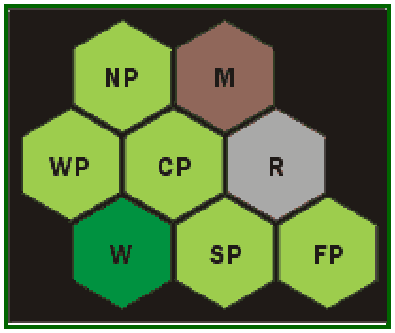

# Small World S22

## Metadata
- **Scenario ID**: `small_world_s22` (`mapPresetId`: `scenario_small_world_s22`)
- **Source**: `http://www.splotter.nl/english/r&b/sws22.html`
- **Goal**: Find how to get the most points on the map shown.
- **Conditions**: Play without the Planes & Trains expansion set; skip the first four rows of the wonder; play 20 turns.
- **Current Record**: **360** (2 shares, 1 coin, 2 gold, 6 wonder rows) (+7 geese) — by Herman Haverkort
- **Level**: difficult
- **Status**: well-studied

## Scenario Briefing & Rules
> This map was found as a result from the Paradise-puzzles: it has just enough tiles to be able to produce shares. This Small World puzzle is purely an exercise in effective map lay-out, clever road building and efficient donkey scheduling. You do not have to think about the buildings you need: without shares you cannot get 360 points, and for shares you need a woodcutter, a quarry, a saw-mill, a mine, a paper-mill, a coal-burner, a mint and a stock-exchange. All wood, except what is produced in turn 19 and 20, is needed for building, fuel and paper - only if you renounce the last new mine shaft, you can contribute two boards to the wonder early in the game. So the only way to raise a substantial contribution to the wonder is... breeding a lot of geese!
>
> We believe that it is impossible to beat the current record of 360 points, although believes like this were proven wrong before... To see how close you can get to another row in the wonder, after reaching 360 points, count the number of unused geese you can collect at your starting place at the end of the game.

## Exact Map Geometry
- **Hex Orientation**: `pointy` (horizontal staggered rows: `2 - 3 - 3`)
- **Total Tiles**: 8
- **Default App Starting Hex**: `CP` `(0, 0)` (central pasture)

### Tiles (`(q, r)` Axial)
| Row (`r`) | Code | `(q, r)` | Terrain | Notes |
|-----------|------|----------|---------|-------|
| `-1` | `NP` | `(0, -1)` | `pasture` | North pasture |
| `-1` | `M` | `(1, -1)` | `mountain` | Single mountain |
| `0` | `WP` | `(-1, 0)` | `pasture` | West pasture |
| `0` | `CP` | `(0, 0)` | `pasture` | Central pasture (Default home) |
| `0` | `R` | `(1, 0)` | `rock` | Single rock |
| `+1` | `W` | `(-1, 1)` | `forest` | Single forest |
| `+1` | `SP` | `(0, 1)` | `pasture` | South pasture |
| `+1` | `FP` | `(1, 1)` | `pasture` | Far-east pasture |

### Rivers & Railroads
- None.
