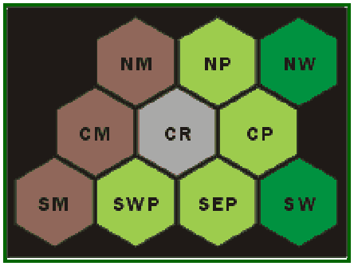

# Small World S33

## Metadata
- **Scenario ID**: `small_world_s33` (`mapPresetId`: `scenario_small_world_s33`)
- **Source**: `http://www.splotter.nl/english/r&b/sws33.html`
- **Goal**: Find how to get the most points on the map shown.
- **Conditions**: Play without the Planes & Trains expansion set; skip the first four rows of the wonder; play 20 turns.
- **Current Record**: **510** (3 shares, 1 coin, 5 gold, 6 wonder rows) — by Herman Haverkort
- **Level**: very difficult
- **Status**: well-studied

## Scenario Briefing & Rules
> This map was found as a result from the Paradise-puzzles: it has just enough tiles to be able to produce three shares. Theoretically, the record may be broken with 11 coins, some gold and some wonder rows (we would be interested in an analysis showing that it cannot be done), but in practice, you will probably need to reproduce the three shares. For this, you would need two woodcutters, a saw-mill, a quarry, a paper-mill, a coal-burner, two mines, a mint and a stock-exchange. I put three mountain areas in the map, so that you can choose where to put the mines.
>
> You can start on any tile on the board. Before playing, fill the first four rows of the wonder with bricks of unused colours. This means that the first wonder brick in a turn costs two goods right from the beginning. The maximum number of points you can get in the wonder is 80 - the game ends at the two-player mark. You have only 20 turns instead of the usual 33 to finish the game: 13 neutral bricks will not be used. Play by the rules of the second edition. For mining, use the one-player rule (see scenario book).

## Exact Map Geometry
- **Hex Orientation**: `pointy` (horizontal staggered rows: `3 - 3 - 4`)
- **Total Tiles**: 10
- **Default App Starting Hex**: `CP` `(1, 0)` (central-east pasture)

### Tiles (`(q, r)` Axial)
| Row (`r`) | Code | `(q, r)` | Terrain | Notes |
|-----------|------|----------|---------|-------|
| `-1` | `NM` | `(0, -1)` | `mountain` | North mountain |
| `-1` | `NP` | `(1, -1)` | `pasture` | North pasture |
| `-1` | `NW` | `(2, -1)` | `forest` | North forest |
| `0` | `CM` | `(-1, 0)` | `mountain` | Center mountain |
| `0` | `CR` | `(0, 0)` | `rock` | Center rock |
| `0` | `CP` | `(1, 0)` | `pasture` | Center pasture (Default home) |
| `+1` | `SM` | `(-2, 1)` | `mountain` | South mountain |
| `+1` | `SWP` | `(-1, 1)` | `pasture` | Southwest pasture |
| `+1` | `SEP` | `(0, 1)` | `pasture` | Southeast pasture |
| `+1` | `SW` | `(1, 1)` | `forest` | South forest |

### Rivers & Railroads
- None.
