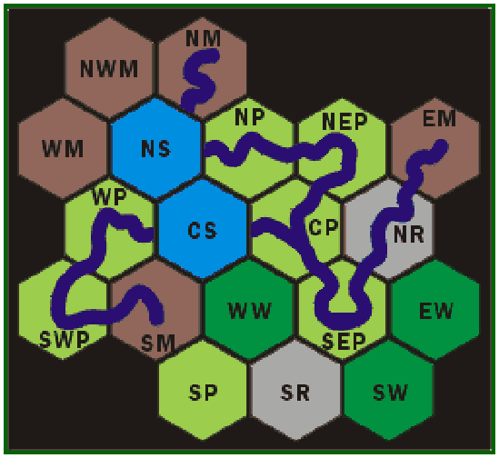

# Small World S52

## Metadata
- **Scenario ID**: `small_world_s52` (`mapPresetId`: `scenario_small_world_s52`)
- **Source**: `http://www.splotter.nl/english/r&b/sws52.html`
- **Goal**: Find how to get the most points on the map shown.
- **Conditions**: Play without the Planes & Trains expansion set; skip the first four rows of the wonder; play 20 turns.
- **Current Record**: **650** (5 shares, 5 wonder rows) — by Uwe Gemming
- **Level**: very difficult
- **Status**: well-studied

## Scenario Briefing & Rules
> This map, constructed by Uwe Gemming, is the smallest known map on which five shares can be produced in 20 turns. It is hard to say whether or not it is difficult to match or break the record on this map. On one hand, the map was designed to fit a particular strategy, so you might need to reproduce that exact strategy to achieve the maximum score. On the other hand, the map might guide you to the right strategy because everything is exactly in the right place. Or... maybe the map is misleading after all. Could Uwe, being focussed on making five shares, have overlooked a better solution with less shares, but more coins, on this map?
>
> You can start on any tile on the board. Before playing, fill the first four rows of the wonder with bricks of unused colours. This means that the first wonder brick in a turn costs two goods right from the beginning. The maximum number of points you can get in the wonder is 80 - the game ends at the two-player mark. You have only 20 turns instead of the usual 33 to finish the game: 13 neutral bricks will not be used. Play by the rules of the second edition. For mining, use the one-player rule (see scenario book).

## Exact Map Geometry
- **Hex Orientation**: `pointy` (horizontal staggered rows: `2 - 5 - 4 - 5 - 3`)
- **Total Tiles**: 19
- **Default App Starting Hex**: `CP` `(1, 0)` (central pasture)

### Tiles (`(q, r)` Axial)
| Row (`r`) | Code | `(q, r)` | Terrain | Notes |
|-----------|------|----------|---------|-------|
| `-2` | `NWM` | `(0, -2)` | `mountain` | Northwest mountain |
| `-2` | `NM` | `(1, -2)` | `mountain` | North river source |
| `-1` | `WM` | `(-1, -1)` | `mountain` | West mountain |
| `-1` | `NS` | `(0, -1)` | `water` | North sea |
| `-1` | `NP` | `(1, -1)` | `pasture` | North pasture |
| `-1` | `NEP` | `(2, -1)` | `pasture` | Northeast pasture |
| `-1` | `EM` | `(3, -1)` | `mountain` | East river source |
| `0` | `WP` | `(-1, 0)` | `pasture` | West pasture |
| `0` | `CS` | `(0, 0)` | `water` | Central sea |
| `0` | `CP` | `(1, 0)` | `pasture` | Central pasture (Default home) |
| `0` | `NR` | `(2, 0)` | `rock` | East rock |
| `+1` | `SWP` | `(-2, 1)` | `pasture` | Southwest pasture |
| `+1` | `SM` | `(-1, 1)` | `mountain` | South mountain (west river source) |
| `+1` | `WW` | `(0, 1)` | `forest` | West forest |
| `+1` | `SEP` | `(1, 1)` | `pasture` | Southeast pasture |
| `+1` | `EW` | `(2, 1)` | `forest` | East forest |
| `+2` | `SP` | `(-1, 2)` | `pasture` | South pasture |
| `+2` | `SR` | `(0, 2)` | `rock` | South rock |
| `+2` | `SW` | `(1, 2)` | `forest` | South forest |

### Rivers (11 Edges)
- **Northern short stream**: `NM (1, -2) <-> NS (0, -1)`
- **Western stream**: `SM (-1, 1) <-> SWP (-2, 1) <-> WP (-1, 0) <-> CS (0, 0)`
- **Eastern / central loop**: `NS (0, -1) <-> NP (1, -1) <-> NEP (2, -1) <-> CP (1, 0) <-> SEP (1, 1) <-> NR (2, 0) <-> EM (3, -1)`
- **Central connector**: `CP (1, 0) <-> CS (0, 0)`

### Railroads
- None.
