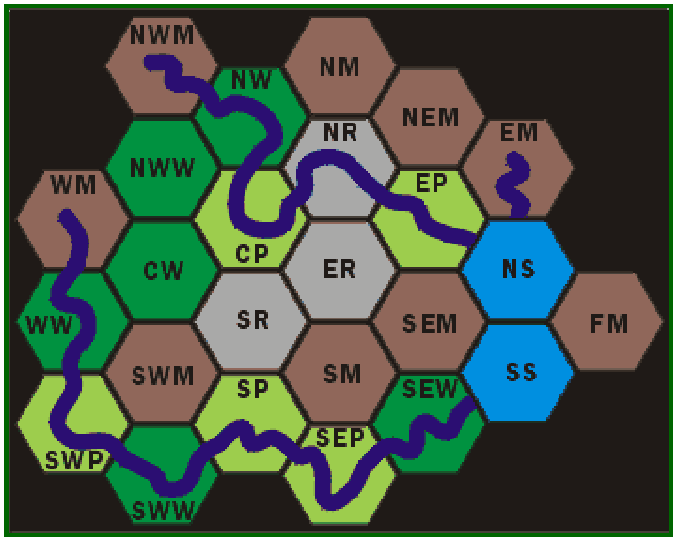

# Small World SX2

## Metadata
- **Scenario ID**: `small_world_sx2` (`mapPresetId`: `scenario_small_world_sx2`)
- **Source**: `http://www.splotter.nl/english/r&b/swsx2.html`
- **Goal**: Find how to get the most points on the map shown.
- **Conditions**: Play without the Planes & Trains expansion set; skip the first four rows of the wonder; play 20 turns.
- **Current Record**: **800** (6 shares, 1 coin, 2 gold, 2 wonder rows) — by Herman Haverkort
- **Level**: very difficult
- **Status**: well-studied

## Scenario Briefing & Rules
> On this map, it is possible to achieve the highest score anyone has achieved on any map in 20 turns. The map was actually designed for this purpose as part of the Paradise-puzzles. It is hard to say whether or not it is difficult to match or break the record on this map. On one hand, the map was designed to fit a particular strategy, so you might need to reproduce that exact strategy to achieve the maximum score. On the other hand, the map might guide you to the right strategy because everything is exactly in the right place. Or... maybe the map is misleading after all, and Herman, with his head full of the five and six shares' Paradise puzzels which led to this map, was blind to the real optimal strategy.
>
> You can start on any tile on the board. Before playing, fill the first four rows of the wonder with bricks of unused colours. This means that the first wonder brick in a turn costs two goods right from the beginning. The maximum number of points you can get in the wonder is 80 - the game ends at the two-player mark. You have only 20 turns instead of the usual 33 to finish the game: 13 neutral bricks will not be used. Play by the rules of the second edition. For mining, use the one-player rule (see scenario book).

## Exact Map Geometry
- **Hex Orientation**: `flat` (vertical staggered columns: `3 - 5 - 4 - 5 - 4 - 3 - 1`)
- **Total Tiles**: 25
- **Default App Starting Hex**: `CP` `(-1, 0)` (central pasture)

### Tiles (`(q, r)` Axial — Flat-Topped)
| Col (`q`) | Code | `(q, r)` | Terrain | Notes |
|-----------|------|----------|---------|-------|
| `-3` | `WM` | `(-3, 1)` | `mountain` | West mountain (south river source) |
| `-3` | `WW` | `(-3, 2)` | `forest` | West forest |
| `-3` | `SWP` | `(-3, 3)` | `pasture` | Southwest pasture |
| `-2` | `NWM` | `(-2, -1)` | `mountain` | Northwest mountain (north river source) |
| `-2` | `NWW` | `(-2, 0)` | `forest` | Northwest forest |
| `-2` | `CW` | `(-2, 1)` | `forest` | Central-west forest |
| `-2` | `SWM` | `(-2, 2)` | `mountain` | Southwest mountain |
| `-2` | `SWW` | `(-2, 3)` | `forest` | Southwest forest |
| `-1` | `NW` | `(-1, -1)` | `forest` | North forest |
| `-1` | `CP` | `(-1, 0)` | `pasture` | Central pasture (Default home) |
| `-1` | `SR` | `(-1, 1)` | `rock` | South rock |
| `-1` | `SP` | `(-1, 2)` | `pasture` | South pasture |
| `0` | `NM` | `(0, -2)` | `mountain` | North mountain |
| `0` | `NR` | `(0, -1)` | `rock` | North rock |
| `0` | `ER` | `(0, 0)` | `rock` | East-center rock |
| `0` | `SM` | `(0, 1)` | `mountain` | South mountain |
| `0` | `SEP` | `(0, 2)` | `pasture` | Southeast pasture |
| `+1` | `NEM` | `(1, -2)` | `mountain` | Northeast mountain |
| `+1` | `EP` | `(1, -1)` | `pasture` | East pasture |
| `+1` | `SEM` | `(1, 0)` | `mountain` | Southeast mountain |
| `+1` | `SEW` | `(1, 1)` | `forest` | Southeast forest |
| `+2` | `EM` | `(2, -2)` | `mountain` | East mountain (NE tributary source) |
| `+2` | `NS` | `(2, -1)` | `water` | North sea |
| `+2` | `SS` | `(2, 0)` | `water` | South sea |
| `+3` | `FM` | `(3, -1)` | `mountain` | Far-east mountain |

### Rivers (13 Edges)
- **Northern river (to `NS`)**:
  - `NWM (-2, -1) <-> NW (-1, -1) <-> CP (-1, 0) <-> NR (0, -1) <-> EP (1, -1) <-> NS (2, -1)`
- **Northeast tributary (to `NS`)**:
  - `EM (2, -2) <-> NS (2, -1)`
- **Southern river (to `SS`)**:
  - `WM (-3, 1) <-> WW (-3, 2) <-> SWP (-3, 3) <-> SWW (-2, 3) <-> SP (-1, 2) <-> SEP (0, 2) <-> SEW (1, 1) <-> SS (2, 0)`

### Railroads
- None.
