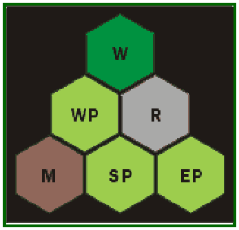

# Tierra del Fuego S11

## Metadata
- **Scenario ID**: `tierra_del_fuego_s11` (`mapPresetId`: `scenario_tierra_del_fuego_s11`)
- **Source**: `http://www.splotter.nl/english/r&b/tfs11.html`
- **Goal**: Find how to get the most points on the map shown.
- **Conditions**: You may take advantage of the Planes & Trains expansion set; skip the first four rows of the wonder; play 20 turns.
- **Current Record**: **230** (1 share, 1 coin, 7 wonder rows) — by Herman Haverkort
- **Level**: difficult
- **Status**: well-studied

## Scenario Briefing & Rules
> This map has just enough tiles to be able to produce bombs, and if you use them properly, you can make (at least) one share, even on this extremely small map. Transport is hardly a problem on this map: everything is close together. Your main issues are: when is pasture built upon (putting an end to geese production for the wonder), and which buildings are blown up to make place for at least a paper-mill, a mint and a stock exchange?
>
> You can start on any tile on the board. Before playing, fill the first four rows of the wonder with bricks of unused colours. This means that the first wonder brick in a turn costs two goods right from the beginning. The maximum number of points you can get in the wonder is 80 - the game ends at the two-player mark. You have only 20 turns instead of the usual 33 to finish the game: 13 neutral bricks will not be used. Play by the rules of the second edition. For mining, use the one-player rule (see scenario book).

## Exact Map Geometry
- **Hex Orientation**: `pointy` (horizontal staggered pyramid rows: `1 - 2 - 3`)
- **Total Tiles**: 6
- **Default App Starting Hex**: `WP` `(-1, 0)` (west pasture)

### Tiles (`(q, r)` Axial)
| Row (`r`) | Code | `(q, r)` | Terrain | Notes |
|-----------|------|----------|---------|-------|
| `-1` | `W` | `(0, -1)` | `forest` | Single forest peak |
| `0` | `WP` | `(-1, 0)` | `pasture` | West pasture (Default home) |
| `0` | `R` | `(0, 0)` | `rock` | Single rock |
| `+1` | `M` | `(-2, 1)` | `mountain` | Single mountain |
| `+1` | `SP` | `(-1, 1)` | `pasture` | South pasture |
| `+1` | `EP` | `(0, 1)` | `pasture` | East pasture |

### Rivers & Railroads
- None.
